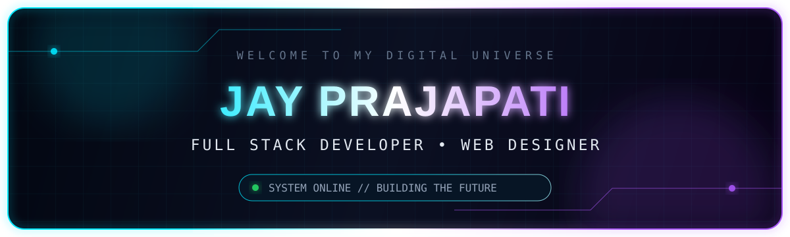

<!--
  GitHub Profile README for Jay Prajapati (@Jay-1107)
  Install in the profile repository: https://github.com/Jay-1107/jay-1107
  Keep the assets/ folder beside this README.md.
-->

<div align="center">
  <a href="https://github.com/Jay-1107">
    
  </a>

  <br />

  

  <br />

  <a href="https://komarev.com/ghpvc/?username=Jay-1107&style=for-the-badge&color=00b8d4&label=PROFILE+VIEWS">
    
  </a>
  <a href="https://github.com/Jay-1107?tab=followers">
    
  </a>
  <a href="https://github.com/Jay-1107?tab=repositories">
    
  </a>
</div>

<br />

## `> SYSTEM_PROFILE`

```yaml
name: Jay Prajapati
location: Gujarat, India
role: Full Stack Developer & Web Designer
focus: [React.js, Next.js, TypeScript, Node.js, WordPress, YOOtheme]
mission: Turning ideas into fast, responsive and user-focused digital products.
status: Learning continuously. Building consistently.
```

I build modern web experiences across the frontend and backend—from responsive interfaces in **React.js** and **Next.js** to APIs, databases and content-managed websites. I also work with **WordPress** and **YOOtheme**, using AI-assisted development thoughtfully to research, prototype and ship better solutions faster.

- 🔭 Building full-stack projects and polished web interfaces
- 🌱 Deepening my skills in **TypeScript, Next.js, Node.js and scalable application design**
- 🧠 Interested in **AI-assisted development, prompt engineering and developer productivity**
- 🎯 Focused on clean code, responsive design, accessibility and real-world usability
- 🤝 Open to internships, junior developer roles and meaningful collaborations

<div align="center">
  
</div>

## `> TECH_ARSENAL`

<div align="center">
  <h3>Frontend</h3>
  

  <h3>Backend & Databases</h3>
  

  <h3>CMS, Design & Developer Tools</h3>
  

  <br />
  <br />

  
  
  
</div>

> The dark icon tiles create a compact, dimensional technology wall. **YOOtheme** is listed accurately throughout the profile.

<div align="center">
  
</div>

## `> FEATURED_BUILDS`

<div align="center">
  <a href="https://github.com/Jay-1107/3D_Portfolio">
    
  </a>
  <a href="https://github.com/Jay-1107/ecommerce-react">
    
  </a>
  <a href="https://github.com/Jay-1107/CityCare_Hospital">
    
  </a>
  <a href="https://github.com/Jay-1107/Employee_Management">
    
  </a>
</div>

<div align="center">
  <a href="https://jayprajapatiportfolio-opal.vercel.app"><b>3D Portfolio — Live Demo</b></a>
  &nbsp;•&nbsp;
  <a href="https://ecommerce-react-gamma-nine.vercel.app"><b>E-commerce — Live Demo</b></a>
  &nbsp;•&nbsp;
  <a href="https://city-care-hospital.vercel.app"><b>CityCare — Live Demo</b></a>
</div>

<div align="center">
  
</div>

## `> GITHUB_ANALYTICS`

<div align="center">
  
  
</div>

<div align="center">
  
</div>

<sub>Statistics are generated from public GitHub activity and may be cached by the third-party card services.</sub>

<div align="center">
  
</div>

## `> CONNECT`

<div align="center">
  <p>Have a project, opportunity or interesting idea? Let’s build something useful.</p>

  <a href="https://www.linkedin.com/in/jay-prajapati-b68809282/">
    
  </a>
  <a href="https://github.com/Jay-1107">
    
  </a>
  <a href="https://drive.google.com/file/d/1ZdPnXiOiTpMfW0KYKQq0N1wGgbhJm2IL/view">
    
  </a>
</div>

<br />

<div align="center">
  
  <br />
  <sub>Designed with curiosity, code and a little neon energy.</sub>
</div>
