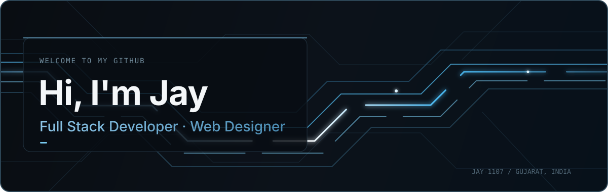

<!-- GitHub profile README for github.com/Jay-1107 -->

  

   

  <h1>Jay Prajapati — Full Stack Developer &amp; Web Designer</h1>
  
React.js · Next.js · TypeScript · Node.js · WordPress · YOOtheme

  
  
  

---

## About Me

<table>
  <tr>
    <td width="34%" align="center">
      
    </td>
    <td width="66%">
      I'm <b>Jay Prajapati</b>, a Full Stack Developer and Web Designer from Gujarat, India. I build responsive web applications with <b>React.js, Next.js and TypeScript</b>, work across the backend with <b>Node.js and Express.js</b>, and create content-managed websites using <b>WordPress and YOOtheme</b>.
        
      I enjoy turning ideas into clear, useful interfaces and continuously improving the way I design, build and ship for the web.
    </td>
  </tr>
</table>

---

## Selected Projects

<table>
  <tr>
    <td width="50%" valign="top">
      <h3>3D Portfolio</h3>
      
Interactive portfolio with a 3D character scene, scroll-led transitions and a component-based React architecture.

      
<code>React</code> <code>TypeScript</code> <code>Three.js</code> <code>GSAP</code>

      <a href="https://github.com/Jay-1107/3D_Portfolio">Source</a> · <a href="https://jayprajapatiportfolio-opal.vercel.app">Live Site</a>
    </td>
    <td width="50%" valign="top">
      <h3>Premium Coffee Store</h3>
      
Responsive storefront with product browsing, cart flows, authentication screens, theme switching and smooth interactions.

      
<code>React</code> <code>JavaScript</code> <code>Web Design</code>

      <a href="https://github.com/Jay-1107/ecommerce-react">Source</a> · <a href="https://ecommerce-react-gamma-nine.vercel.app">Live Site</a>
    </td>
  </tr>
  <tr>
    <td width="50%" valign="top">
      <h3>CityCare Hospital</h3>
      
Healthcare website focused on clear information hierarchy, responsive layouts and accessible navigation.

      
<code>React</code> <code>JavaScript</code> <code>CSS3</code>

      <a href="https://github.com/Jay-1107/CityCare_Hospital">Source</a> · <a href="https://city-care-hospital.vercel.app">Live Site</a>
    </td>
    <td width="50%" valign="top">
      <h3>Employee Management</h3>
      
Frontend application for organizing employee information and practicing practical dashboard UI patterns.

      
<code>React</code> <code>JavaScript</code> <code>CSS3</code>

      <a href="https://github.com/Jay-1107/Employee_Management">Source</a> · <a href="https://employee-management-inky.vercel.app">Live Site</a>
    </td>
  </tr>
</table>

---

<h2 align="center">Tech Stack</h2>

<h3 align="center">Frontend Development</h3>

<table align="center">
  <tr>
    <td align="center" width="105"> React.js</td>
    <td align="center" width="105"> Next.js</td>
    <td align="center" width="105"> JavaScript</td>
    <td align="center" width="105"> TypeScript</td>
    <td align="center" width="105"> HTML5</td>
    <td align="center" width="105"> CSS3</td>
  </tr>
</table>

<h3 align="center">Backend Development</h3>

<table align="center">
  <tr>
    <td align="center" width="120"> Node.js</td>
    <td align="center" width="120"> Express.js</td>
  </tr>
</table>

<h3 align="center">Databases</h3>

<table align="center">
  <tr>
    <td align="center" width="120"> MongoDB</td>
    <td align="center" width="120"> PostgreSQL</td>
  </tr>
</table>

<h3 align="center">CMS, Design & Development Approach</h3>

<table align="center">
  <tr>
    <td align="center" width="150"> WordPress</td>
    <td align="center" width="150"> YOOtheme</td>
    <td align="center" width="170"> Web Design</td>
    <td align="center" width="190"> AI-Assisted Development</td>
    <td align="center" width="170"> Prompt Engineering</td>
  </tr>
</table>

---

## GitHub Analytics

  
  

  

---

<h2 align="center">⌘ Commit Activity</h2>

  
    
  

---

## Let's Connect

  
I'm open to developer opportunities, internships and meaningful web collaborations.

  

    

  

